# Hi, I'm Daniel 

**Integration engineer** in Australia, writing mostly **Python** and **JavaScript/TypeScript**. On the side I'm studying IT part-time at uni, and building small tools that solve real problems.

**Ethos:** continual learning and integration.

🌐 **[dcodeaus.github.io](https://dcodeaus.github.io/)**

---

## Things you can try right now

- 👕 **[Off the Peg](https://dcodeaus.github.io/WardrobeTracker/)**: a wardrobe tracker that shows what your clothes actually cost per wear
- 🤖 **[AI Explained](https://dcodeaus.github.io/aiExplained/)**: a beginner's guide to LLMs with interactive demos and quizzes
- 🏁 **[Build Days Hackathons](https://dcodeaus.github.io/hackathon-tracker/)**: upcoming hackathons, build days and AI meetups around Australia
- 🌦️ **[Typing Weather](https://dcodeaus.github.io/typingWeatherTracker/)**: your typing rhythm turned into a weather report
- ✋ **[Finger Pulley Lab](https://dcodeaus.github.io/finger-pulley-lab/)**: an interactive hand and 3D finger showing how tendons and pulleys work, including trigger finger
- 🔐 **[Offline Code Lab](https://dcodeaus.github.io/totp-offline-lab/)**: how authenticator codes work without internet, with a 3D demo and a live code calculation

## Tools I've built

- 📏 **[Agent Rules](https://github.com/DCodeAus/agent-rules)**: rules-file templates for AI coding agents that work with any model or tool, plus a linter that catches rules likely to go stale
- 🌹 **[Rosé All Night](https://github.com/DCodeAus/dusk-rose-theme)**: a low eye-strain VS Code theme (dark and light) with matching terminal colours
- 📚 **[Atlassian Confluence Scraping](https://github.com/DCodeAus/AtlassianConfluenceScraping)**: moves a team's docs from Confluence to Azure DevOps Wiki or SharePoint, no admin rights needed
- 🔋 **[Codex Battery Monitor](https://github.com/DCodeAus/macCodexBatteryUsageMonitor)**: diagnoses battery drain from screen-capturing AI agents on Apple silicon
- 🗂️ **[Save Safari Tabs](https://github.com/DCodeAus/SaveSafariTabs)**: saves every open tab to Markdown before an exam or hackathon

---

## What I work with

**Languages:** Python · JavaScript · TypeScript · Node.js · Bash · PowerShell · SQL · HTML/CSS

**Interested in:** Cyber security · Networking and infrastructure · Integration and middleware · AI and automation

**How I learn:** by building. AI has made genuinely personal software possible, and it makes a pretty good teacher too.

**Outside of work:** tinkering with Raspberry Pis and e-ink displays: name badges, a [Bitcoin ticker](https://github.com/DCodeAus/Pi_Projects), and whatever the next idea is.

---

## Contribution Graph

<picture>
  <source media="(prefers-color-scheme: dark)" srcset="https://raw.githubusercontent.com/DCodeAus/DCodeAus/output/pacman-contribution-graph-dark.svg">
  <source media="(prefers-color-scheme: light)" srcset="https://raw.githubusercontent.com/DCodeAus/DCodeAus/output/pacman-contribution-graph.svg">
  
</picture>

Generated with thanks to [abozanona](https://abozanona.github.io/pacman-contribution-graph/)

## Streak 🔥

## Get In Touch

- 💬 Want to collaborate or have a question? Open an issue on any of my repositories
- 🌐 **Homepage:** [dcodeaus.github.io](https://dcodeaus.github.io/)
- :octocat: **GitHub:** [@DCodeAus](https://github.com/DCodeAus)
